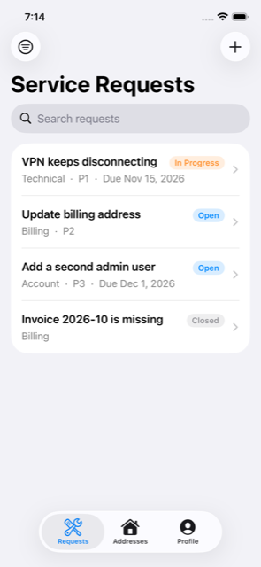
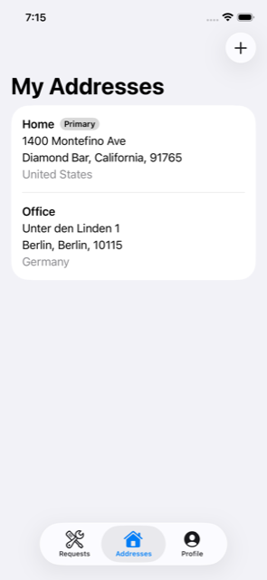
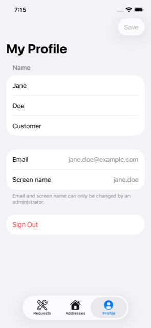

# 00 — Introduction

This tutorial builds a **native iOS app on Liferay DXP 2026.Q1** from scratch: a self-service app in
which a user signs in with their Liferay account and manages their own data.

| Requests | Addresses | Profile |
|---|---|---|
|  |  |  |

## Why this tutorial

Liferay retired **Liferay Screens** and the **Mobile SDK** in 7.4. Its guidance for mobile apps is to use
the **headless REST APIs** directly, but there was no end-to-end example of doing so from a native app:
signing a user in securely, respecting their permissions, and reading and writing both built-in and custom
data. This tutorial fills that gap. Along the way it documents the Liferay behaviours that will surprise
you, each one found against a running server and re-checked on every CI run.

## What you'll build

- **Sign-in** with Liferay's own page, using **OAuth 2.0 Authorization Code + PKCE**: no password in the
  app, no client secret, tokens in the Keychain (chapter 04).
- A small, tested **API client** that refreshes tokens, pages through lists and turns Liferay's errors
  into messages (chapter 05).
- **CRUD on Liferay system objects**: the user's own profile (chapter 06) and postal addresses (chapter 07).
- **CRUD on a custom object**, *Service Request*, with search, filtering and infinite scroll. Each user
  sees only their own requests (chapter 08).

## How it fits together

```
┌──────────────────────── iOS app (SwiftUI) ───────────────────────┐
│  Requests · Addresses · Profile  ──►  screen models (@Observable) │
│                                         │                         │
│  LiferayKit (Swift package, no dependencies)                      │
│   Auth: PKCE · OAuthClient · AuthSession (Keychain, refresh)      │
│   HTTP: APIClient · Endpoint · ListQuery · APIError               │
│   Models: UserAccount · PostalAddress · Country · ServiceRequest  │
└─────────────────────────────────┬─────────────────────────────────┘
                                  │ HTTPS · Bearer token
┌─────────────────────────────────▼─────────────────────────────────┐
│ Liferay DXP 2026.Q1                                               │
│  /o/oauth2/authorize · /o/oauth2/token                            │
│  /o/headless-admin-user/v1.0 (User, Postal Address)               │
│  /o/headless-admin-address/v1.0 (countries, regions)              │
│  /o/c/servicerequests (custom object, generated API)              │
└───────────────────────────────────────────────────────────────────┘
```

## What you need

- A Mac with **Xcode 16 or later**. CI builds with Xcode 26.6.
- **Docker** with at least 6 GB of memory, plus `curl` and `jq`.
- Some Swift and SwiftUI. No prior Liferay knowledge is needed.

## Chapters

| # | Chapter | You'll learn |
|---|---|---|
| 01 | [Run Liferay locally](01-run-liferay.md) | Liferay DXP 2026.Q1 in Docker; the API Explorer |
| 02 | [Configure Liferay](02-configure-liferay.md) | A custom object, permissions, self-service users, the OAuth 2 app |
| 03 | [The iOS project](03-create-ios-project.md) | Project layout, settings in xcconfig, local HTTP |
| 04 | [Sign in with OAuth 2 + PKCE](04-sign-in-oauth-pkce.md) | `ASWebAuthenticationSession`, PKCE, Keychain, sign-out |
| 05 | [The API client](05-api-client.md) | Token refresh, paging, errors, dates, testing without a server |
| 06 | [My Profile](06-my-profile.md) | Read and update the User system object |
| 07 | [My Addresses](07-my-addresses.md) | Postal addresses: Liferay's trickiest system object |
| 08 | [Service Requests](08-service-requests.md) | Full CRUD on a custom object; search, filter, scroll |
| 09 | [Testing](09-testing.md) | Four levels of tests, all in CI |
| 10 | [Production hardening](10-production-hardening.md) | HTTPS, OAuth settings, token lifetimes, App Store |
| 11 | [Next steps](11-next-steps.md) | Attachments, workflow, push, offline |

Start with [01 — Run Liferay DXP 2026.Q1 locally](01-run-liferay.md).
