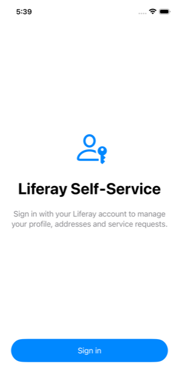

# 03 — Create the iOS project

In this chapter you set up the Xcode project. It has two parts:

- **`LiferayKit`**, a local Swift package with everything that talks to Liferay: OAuth 2, tokens,
  the API client and the models. It has no UI and no third-party dependencies, so it is easy to test.
- **`LiferaySelfService`**, the SwiftUI app. It holds screens and app state, and uses `LiferayKit`.

Splitting them keeps networking code out of views, and lets the package's unit tests run without a
simulator. The CI even runs them on Linux.

**Time:** about 10 minutes. **You need:** a Mac with Xcode 16 or later, and Liferay set up as in
chapters 01–02, with the OAuth 2 application's **Client ID** to hand.

> **Status:** CI builds this project with Xcode 26.6 on a GitHub-hosted Mac, runs the `LiferayKit`
> tests there and on Linux, and launches the app in the iOS Simulator to the sign-in screen.

## 1. What is already in the repository

```
ios/
├── Config/
│   ├── Shared.xcconfig            # includes Local.xcconfig if present
│   └── Local.xcconfig.example     # copy to Local.xcconfig (git-ignored)
├── LiferaySelfService.xcodeproj    # generated from project.yml (committed)
├── project.yml                    # XcodeGen spec for the project
├── LiferayKit/                    # Swift package (chapters 04–05)
│   ├── Package.swift
│   ├── Sources/LiferayKit/{Auth,HTTP,Models}/
│   └── Tests/LiferayKitTests/     # unit tests + recorded Liferay responses
└── LiferaySelfService/            # app sources
    ├── App/                       # @main, AppModel, RootView
    ├── Features/{Login,Home}/
    └── Info.plist                 # Liferay settings + local HTTP exception
```

## 2. Configure your Liferay settings

```bash
cp ios/Config/Local.xcconfig.example ios/Config/Local.xcconfig
```

Edit `ios/Config/Local.xcconfig` and paste your Client ID:

```
LIFERAY_BASE_URL = http:/$()/localhost:8080
OAUTH_CLIENT_ID = id-5ed879da-…
OAUTH_REDIRECT_URI = com.liferay.sample.selfservice:/$()/oauth2redirect
```

> **Gotcha: `//` in `.xcconfig` files.** In an `.xcconfig` file, `//` starts a comment, so
> `http://localhost:8080` silently becomes `http:`. The empty `$()` breaks up the two slashes and
> expands to nothing at build time.

`Local.xcconfig` is git-ignored: each developer has their own Client ID, and nothing
environment-specific is committed.

## 3. Open the Xcode project

```bash
open ios/LiferaySelfService.xcodeproj
```

The project is already set up:

| Setting | Value |
|---|---|
| Target | `LiferaySelfService` (iOS app, iPhone) |
| Minimum deployment | iOS 17.0 |
| Swift language version | Swift 6 (strict concurrency) |
| Configuration file (Debug and Release) | `Config/Shared.xcconfig`, which includes your `Local.xcconfig` |
| Info.plist | `LiferaySelfService/Info.plist`, merged with Xcode's generated keys |
| Package | `LiferayKit` (local, `ios/LiferayKit`) |
| Bundle identifier | `com.liferay.sample.selfservice` |

To run on a physical iPhone, select your team under **Signing & Capabilities**. The Simulator needs
no signing.

The custom keys in `Info.plist` (`LiferayBaseURL`, `OAuthClientID`, `OAuthRedirectURI`) take their
values from the xcconfig. `LiferayConfiguration(bundle:)` reads them at runtime.

You don't need to register the `com.liferay.sample.selfservice` URL scheme under *URL Types*:
`ASWebAuthenticationSession` catches the redirect itself (chapter 04).

### How the project file is made (maintainers)

`LiferaySelfService.xcodeproj` is generated from [`ios/project.yml`](../../ios/project.yml) with
[XcodeGen](https://github.com/yonaskolb/XcodeGen), and the result is committed, so readers don't need
XcodeGen. After adding or removing app source files, or changing build settings, regenerate it:

```bash
brew install xcodegen
cd ios && xcodegen generate
```

CI fails if the committed project doesn't match `project.yml`.

## 4. Build settings explained

`Shared.xcconfig` contains only `#include? "Local.xcconfig"`. The `?` makes the include optional, so
the project still opens without your local file and shows **Not configured** at runtime instead of
failing to build.

## 5. The LiferayKit package

The app target depends on the local package `ios/LiferayKit`. You can also open
`ios/LiferayKit/Package.swift` on its own in Xcode, or run its tests from Terminal:

```bash
cd ios/LiferayKit && swift test
```

## 6. Allow HTTP to localhost (local development only)

The local Liferay runs on plain `http://localhost:8080`. App Transport Security blocks plain HTTP by
default, so `Info.plist` sets **`NSAllowsLocalNetworking`**. That allows HTTP only to local
addresses such as `localhost`, never to internet hosts. A real Liferay must use HTTPS, and chapter 10
covers removing this exception.

## Checkpoint

- Select an iPhone simulator and press **⌘R**.
- The app shows **Liferay Self-Service** with a **Sign in** button:

  

- If you see **Not configured** instead, `ios/Config/Local.xcconfig` is missing or contains an
  unescaped `//`.
- Optionally, in Terminal: `cd ios/LiferayKit && swift test`. All tests should pass.

Next: [04 — Sign in with OAuth 2 + PKCE](04-sign-in-oauth-pkce.md).
