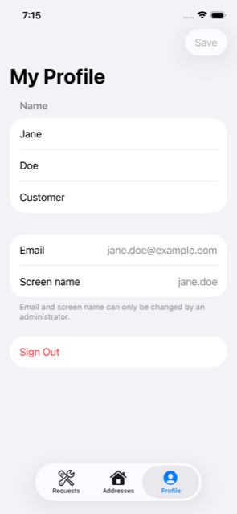

# 06 — My Profile (system object: User)

> **Unofficial reference.** This tutorial is an unofficial reference, not official Liferay
> documentation, and is not supported by Liferay. See [learn.liferay.com](https://learn.liferay.com)
> for official documentation.

The first screen with real data: the signed-in user reads and edits their own **User** record. User is
one of Liferay's built-in *system objects*; the app reaches it through `headless-admin-user`.

**Time:** about 20 minutes. **Status:** the API calls are checked against Liferay DXP 2026.Q1 on every
CI run (`smoke-test.sh`), the models are unit-tested, and CI builds the screen and screenshots it in
demo mode.



## 1. Read: who am I?

```swift
let me = try await api.send(UserAccount.me)   // GET /o/headless-admin-user/v1.0/my-user-account
```

`my-user-account` needs no id, which makes it the natural first call after sign-in. `AppModel`
already makes it in chapter 04 and keeps the result in `.signedIn(user)`.

[`UserAccount`](../../ios/LiferayKit/Sources/LiferayKit/Models/UserAccount.swift) decodes only the
fields the app shows. Most are optional, because Liferay omits fields that have no value. For example,
`lastLoginDate` is missing until the user has signed in through the browser at least once.

## 2. Update: PATCH only what changed

[`UserProfileDraft`](../../ios/LiferayKit/Sources/LiferayKit/Models/UserProfile.swift) holds the three
fields a user may change, and encodes only those:

```swift
let updated = try await api.send(UserAccount.updateProfile(of: user.id, with: draft))
// PATCH /o/headless-admin-user/v1.0/user-accounts/{id}
// {"familyName":"Doe","givenName":"Jane","jobTitle":"Analyst"}
```

**PATCH** merges: roles, addresses, email and everything else stay as they are. Sending a whole
`UserAccount` back would risk overwriting fields the app doesn't know about.

After saving, the view tells `AppModel` (`userDidChange`) so every screen shows the new name.

## 3. What a self-service user may do

The user has only Liferay's default **User** role, and Liferay enforces what that allows:

| Action | Allowed? |
|---|---|
| Read and update **their own** account | ✅ |
| Update **another** user (`PATCH user-accounts/{otherId}`) | ❌ `403 Forbidden`, even though the OAuth scope `Liferay.Headless.Admin.User.everything` is granted |
| Create or delete users | ❌ |

The OAuth scope says what the *app* may call; the user's role says what the *user* may do. Both must
allow an action. The form therefore shows email and screen name read-only: changing them needs an
administrator.

## 4. The screen

[`ProfileView`](../../ios/LiferaySelfService/Features/Profile/ProfileView.swift) is a `Form` bound to
the draft:

- **Save** is enabled only when the draft differs from the loaded user (`UserProfileDraft` is `Equatable`).
- Validation runs before the request (`draft.validationErrors`), so empty names never reach Liferay.
- Errors go through `userMessage(for:)`, which turns `APIError` into a short sentence.
- **Sign Out** asks for confirmation, then calls `AppModel.signOut()` (chapter 04).

## Checkpoint

Sign in as Jane, open **Profile**, change the job title and tap **Save**. Then check the change in the
Liferay UI: **Control Panel → Users and Organizations → Jane Doe**.

Next: [07 — My Addresses](07-my-addresses.md).
