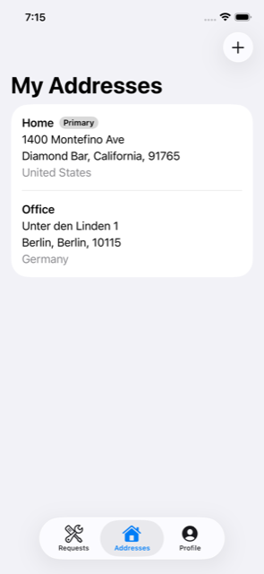

# 07 — My Addresses (system object: Postal Address)

> **Unofficial reference.** This tutorial is an unofficial reference, not official Liferay
> documentation, and is not supported by Liferay. See [learn.liferay.com](https://learn.liferay.com)
> for official documentation.

Full CRUD on a second system object, the user's **postal addresses**. This is the chapter with the most
Liferay surprises; each one below was found against a running Liferay DXP 2026.Q1, and
`smoke-test.sh` re-checks it on every CI run.

**Time:** about 30 minutes.



## 1. The endpoints

| Operation | Request |
|---|---|
| List | `GET /o/headless-admin-user/v1.0/user-accounts/{userId}/postal-addresses` |
| **Create** | `PATCH /o/headless-admin-user/v1.0/user-accounts/{userId}` with the **full** address list |
| Update | `PUT /o/headless-admin-user/v1.0/postal-addresses/{id}` |
| Delete | `DELETE /o/headless-admin-user/v1.0/postal-addresses/{id}` |
| Countries and their regions | `GET /o/headless-admin-address/v1.0/countries?pageSize=-1` |

## 2. Creating an address: there is no POST

Accounts and organizations have `POST …/postal-addresses`; **users don't**. A user's addresses can only
be set as part of the user account, and that list *replaces* the existing one:

```swift
// AddressListModel.add(_:)
let current = try await api.send(PostalAddress.list(userAccountID: userAccountID)).items
_ = try await api.send(UserAccount.replaceAddresses(of: userAccountID, with: current + [draft.postalAddress(id: nil)]))
```

```json
PATCH /o/headless-admin-user/v1.0/user-accounts/34267
{ "userAccountContactInformation": { "postalAddresses": [ {"id": 501, …}, {"id": 502, …}, { …the new one… } ] } }
```

> **Gotcha: a missing address is deleted.** Any address left out of the list is removed. The model
> therefore re-reads the list immediately before adding, so an address added elsewhere (in the browser,
> or on another device) since the screen opened isn't lost.

## 3. Writing the country: only the English name works everywhere

The two address endpoints disagree about how the country may be written:

| `addressCountry` sent | `PATCH user-accounts/{id}` (create) | `PUT postal-addresses/{id}` (update) |
|---|---|---|
| `United States` (English name) | ✅ | ✅ |
| `US` (code), `united-states` (key) | ✅ | ❌ `400 Country not found` |
| `Etats-Unis` (localized name) | ⚠️ `200`, but **saved with no country** | ❌ `400` |
| empty | ⚠️ `200`, **saved as Afghanistan** (the first country) | ❌ `400` |

So [`PostalAddressDraft`](../../ios/LiferayKit/Sources/LiferayKit/Models/PostalAddress.swift) holds the
chosen `Country` and always sends its **English name** (`title_i18n.en_US`), whatever the device language.
The picker still *shows* countries in the user's language (`country.title()`).

## 4. Regions are required when the country has them

`PUT postal-addresses/{id}` answers **`400 Region not found`** if the country has regions (US states,
Australian states, German Länder) and none, or one from another country, is sent. Countries without
regions, such as Singapore, need none.

The draft validates this before saving, and sends the **region code** (`CA`, `NSW`, `BE`), which both
endpoints accept. Changing the country in the form clears the region.

```swift
public var validationErrors: [String] {
    …
    if let country {
        if !country.regions.isEmpty, !country.regions.contains(where: { $0.regionCode == regionCode }) {
            errors.append("Choose a state or region.")
        }
    } else {
        errors.append("Choose a country.")
    }
}
```

## 5. Updating: PUT, not PATCH

Liferay's PATCH **ignores `null`**: `{"addressRegion": null}` leaves the region unchanged. The app
updates with **PUT**, which replaces the address, so a field the user cleared really is cleared.
Liferay returns the country and region as display names (`United States`, `California`);
`PostalAddressDraft(address, countries:)` maps them back to the picker's codes.

## 6. Countries are loaded once

`Country.all` returns about 250 countries **with their regions** in one response (`pageSize=-1`).
`AddressListModel` loads them with the first address list, sorts them by the localized name, and keeps
them for the forms.

## 7. The screens

- [`AddressListView`](../../ios/LiferaySelfService/Features/Addresses/AddressListView.swift):
  pull to refresh, tap to edit, swipe to delete (optimistic: the row disappears at once and comes
  back if Liferay refuses).
- [`AddressFormView`](../../ios/LiferaySelfService/Features/Addresses/AddressFormView.swift): text
  fields with address autofill content types, a country picker that opens the full list, and a region
  picker that appears only for countries with regions.

## Checkpoint

1. Add an address in Germany without choosing a region: the form says *Choose a state or region*.
2. Choose *Berlin* and save. The address appears in the list.
3. Edit it, change the country to Singapore: the region picker disappears; save.
4. Check Jane's account in Liferay (**Control Panel → Users and Organizations → Jane Doe**).
5. Swipe to delete it.

Next: [08 — Service Requests](08-service-requests.md).
