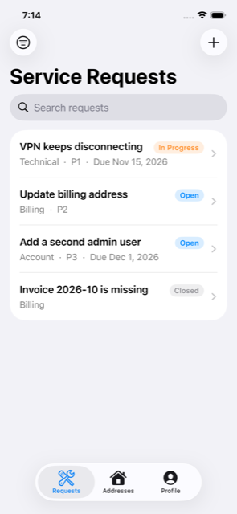

# 08 — Service Requests (custom object)

> **Unofficial reference.** This tutorial is an unofficial reference, not official Liferay
> documentation, and is not supported by Liferay. See [learn.liferay.com](https://learn.liferay.com)
> for official documentation.

Full CRUD on the custom **Service Request** object from chapter 02, with search, a status filter and
infinite scroll. Liferay generated its REST API (`/o/c/servicerequests`) the moment the object was
published; the app treats it like any other API.

**Time:** about 40 minutes.



## 1. The endpoints

| Operation | Request |
|---|---|
| List (paged, searched, filtered) | `GET /o/c/servicerequests?page=1&pageSize=20&sort=dateCreated:desc&search=vpn&filter=requestStatus eq 'open'` |
| Read | `GET /o/c/servicerequests/{id}` |
| **Create (safe to retry)** | `PUT /o/c/servicerequests/by-external-reference-code/{code}` |
| Update | `PUT /o/c/servicerequests/{id}` |
| Delete | `DELETE /o/c/servicerequests/{id}` |

The list returns **only the user's own requests**: Liferay checks the *owner* permission on every
entry (chapter 02). The app never filters by user, and John never sees Jane's requests.

## 2. The model and the draft

[`ServiceRequest`](../../ios/LiferayKit/Sources/LiferayKit/Models/ServiceRequest.swift) decodes what
Liferay returns; `ServiceRequestDraft` encodes only what the user may set:

```json
{"category":{"key":"technical"},"description":"Tray 2","dueDate":"2026-12-24","priority":2,
 "requestStatus":{"key":"open"},"title":"Printer jam"}
```

Three Liferay details shape it:

- **Picklists are sent as `{"key": …}`** and returned as `{"key": …, "name": …}`. An unknown key returns
  `403 Forbidden`, and a self-service user can't read the picklist definitions (`404`), so the app ships
  the keys in `ServiceRequestPicklists` and the pickers offer only those.
- **An empty Integer field comes back as `0`**, not `null`. The model reads `priority: 0` as "no priority".
- **Dates are calendar days.** The draft sends `"2026-12-24"`; Liferay stores midnight UTC and returns
  `2026-12-24T00:00:00.000Z`. The app formats it in UTC so the day doesn't shift west of Greenwich.

## 3. Create without duplicates

Mobile networks drop responses. If "Save" sent a `POST` and the response was lost, tapping "Save"
again would create a second request. Instead, each new form generates an
**external reference code** (a UUID) once, and saves with:

```swift
// ServiceRequestFormView.save()
saved = try await api.send(ServiceRequest.upsert(draft, externalReferenceCode: externalReferenceCode))
// PUT /o/c/servicerequests/by-external-reference-code/3F2A…
```

The first PUT creates the entry; a repeated PUT with the same code updates that same entry (verified
against Liferay 2026.Q1).

## 4. Update with PUT, not PATCH

As with addresses, Liferay's PATCH ignores `null`, so the user could never clear the priority or the
due date. `ServiceRequest.update(_:with:)` uses **PUT** with the whole draft, and the draft writes
explicit `null`s:

```json
{"category":{"key":"billing"},"description":"","dueDate":null,"priority":null,"requestStatus":{"key":"closed"},"title":"…"}
```

## 5. The list: search, filter, infinite scroll

[`ServiceRequestListModel`](../../ios/LiferaySelfService/Features/ServiceRequests/ServiceRequestListModel.swift)
builds a `ListQuery` (chapter 05):

```swift
ListQuery(page: page, pageSize: 20, sort: ["dateCreated:desc"],
          filter: statusFilter.map { "requestStatus eq \(ListQuery.quoted($0))" },
          search: searchText)
```

[`ServiceRequestListView`](../../ios/LiferaySelfService/Features/ServiceRequests/ServiceRequestListView.swift)
wires it to SwiftUI:

- **Search:** `.searchable` binds `searchText`. `.task(id: model.queryKey)` restarts whenever the text or
  the filter changes, waits 350 ms (so typing "printer" sends one request, not seven), then reloads.
  SwiftUI cancels the previous task automatically.
- **Filter:** a toolbar `Menu` with a `Picker` over the status keys.
- **Infinite scroll:** each row's `.task` calls `loadMoreIfNeeded(after:)`; when the last row appears
  and `page < lastPage`, the next page is appended.
- **Delete:** swipe, confirm, and the row disappears at once; if Liferay refuses, it comes back with
  the error message.

## 6. Detail and form

- [`ServiceRequestDetailView`](../../ios/LiferaySelfService/Features/ServiceRequests/ServiceRequestDetailView.swift)
  shows every field, plus who created it and when.
- [`ServiceRequestFormView`](../../ios/LiferaySelfService/Features/ServiceRequests/ServiceRequestFormView.swift)
  serves both create and edit; `Save` is disabled until there is a title.

## Checkpoint

1. Sign in as Jane and create two requests, one *Technical* and one *Billing*.
2. Search for part of a title; filter by *Open*.
3. Edit one: clear its priority and due date, set it to *Closed*. Re-open it: both stay cleared.
4. Sign out, sign in as **John** (`john.roe@example.com`): his list is empty.
5. Signed in to Liferay as the admin, open the **Service Requests** entry that publishing the object
   added to the Control Panel: the admin sees everyone's requests.

Next: [09 — Testing](09-testing.md).
